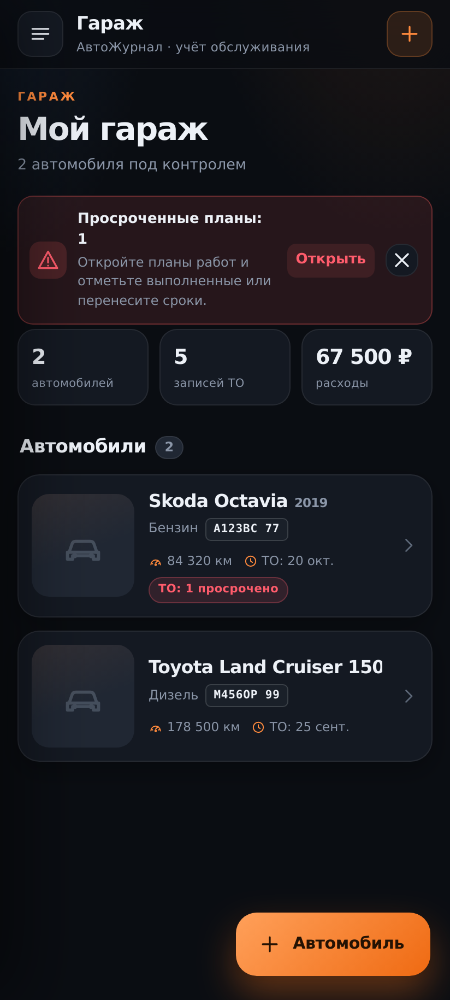
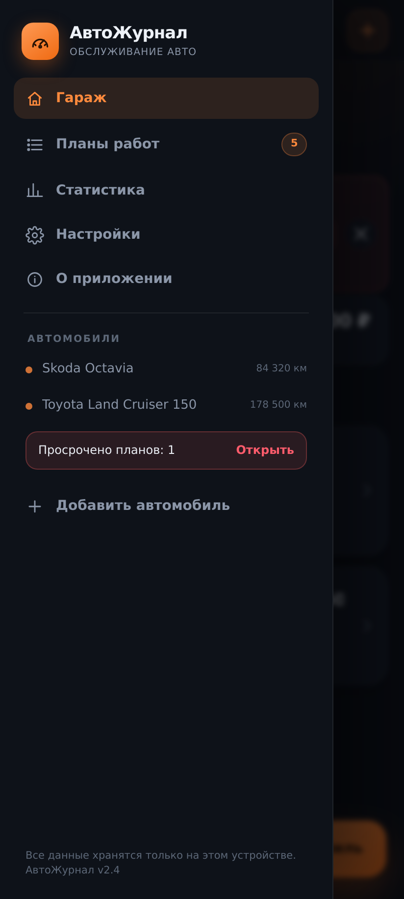
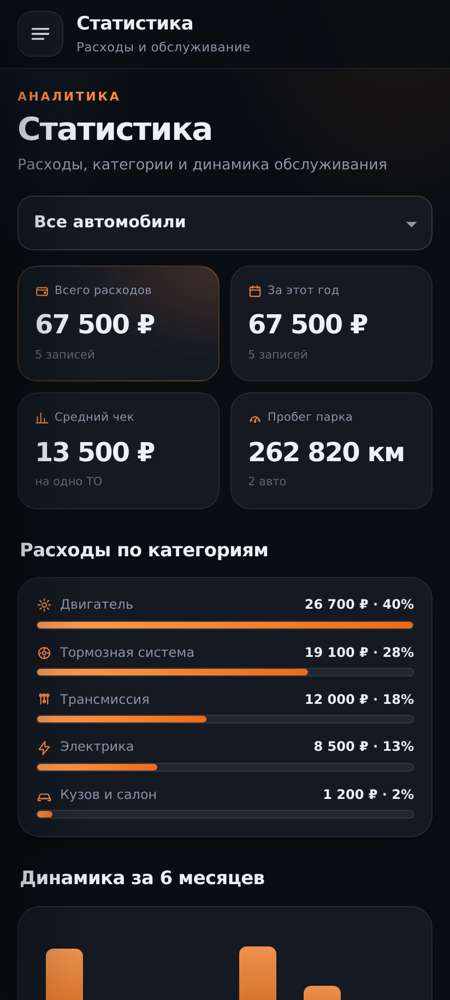
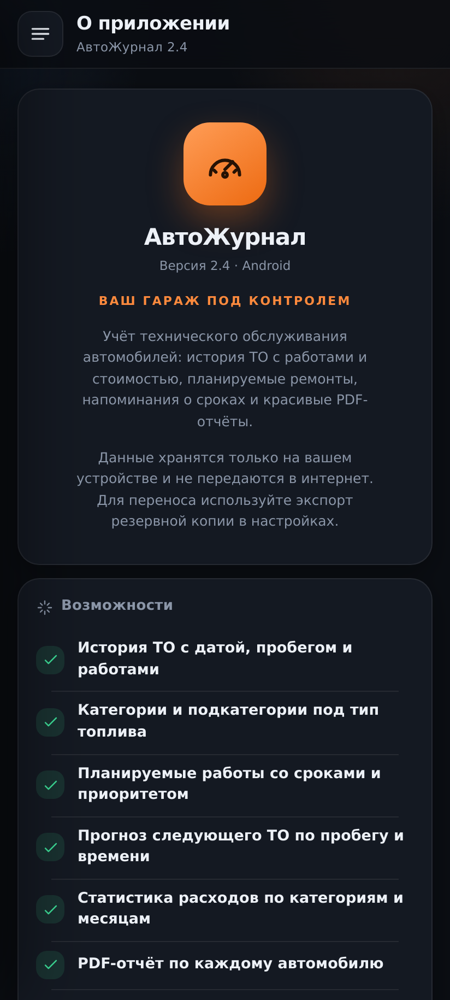
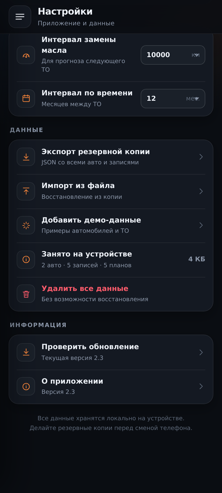
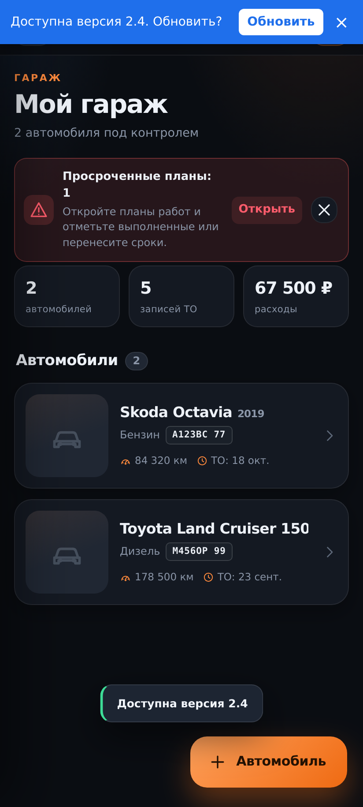

# АвтоЖурнал

**АвтоЖурнал** — Android-приложение для учёта технического обслуживания автомобилей. Работает полностью офлайн: все данные хранятся только на вашем устройстве и никуда не передаются.

Приложение помогает вести историю ТО с работами и стоимостью, планировать ремонты, следить за сроками замены расходников, смотреть статистику расходов и формировать PDF-отчёты. Обновления приходят «по воздуху» через GitHub Releases.

---

## Скриншоты

<p align="center">
  
  
  
</p>

<p align="center">
  
  
  
</p>

<p align="center">
  
  
</p>

---

## Возможности

- Несколько автомобилей в одном гараже
- История ТО: дата, пробег, работы, стоимость, заметки
- Отдельная страница истории ТО со сводкой по работам и расходам и кнопкой «Вся история» в карточке авто
- Категории и подкатегории работ под тип топлива
- Планируемые работы со сроками и приоритетом
- Прогноз следующего ТО по пробегу и времени
- Напоминания о просроченных планах
- Статистика расходов по категориям и месяцам
- Регламент ТО с интервалами, стоимостью работ и запчастями/расходниками
- Документы и неисправности по каждому авто
- PDF-отчёт по автомобилю
- Резервные копии (экспорт/импорт JSON)
- Тёмная, светлая и системная тема
- Работа без интернета и без рекламы

---

## Установка

1. Скачайте APK со страницы [Releases](../../releases/latest).
2. Разрешите установку из неизвестных источников для браузера или файлового менеджера.
3. Установите приложение.

> **Важно:** при переходе с версии **1.x–2.1** сначала удалите старую версию — с v2.2 приложение подписано новым ключом. Начиная с v2.2 обновления ставятся поверх без удаления.

---

## Обновления по воздуху (OTA)

Приложение проверяет обновления через файл [`version.json`](version.json) в ветке `main`:

```json
{
  "version": "2.4",
  "versionCode": 15,
  "url": "https://github.com/s0kkia/AvtoJournal/releases/download/v2.4/AvtoJournal-v2.4-ota.apk",
  "sha256": "70a7cc02507fd2dcf1ae0415202fe4f1fa99adbee0b1b63a6f28f81268f53272",
  "changelog": "Кнопка «Вся история» в карточке авто, прогресс скачивания OTA и авто-открытие установщика."
}
```

Как это работает:

1. При запуске приложение запрашивает `version.json` и сравнивает `versionCode` с текущим.
2. Если доступна новая версия — сверху появляется баннер **«Обновление vX»**.
3. Проверить вручную можно в **Настройки → Информация → Проверить обновление**.
4. По нажатию **«Обновить»** APK скачивается внутри приложения: виден прогресс, после завершения установщик открывается автоматически.
5. Если нативный загрузчик недоступен, приложение откроет ссылку в браузере.

> Полностью «тихая» установка без подтверждения на обычном Android невозможна — это ограничение безопасности системы. Требуется одно системное подтверждение установки.

---

## История версий

| Версия | Что нового |
|--------|------------|
| **2.4** | Отдельная история ТО со сводкой расходов, расширенные справочники работ, синхронизация названий ТО и регламента, стоимость работы в регламенте |
| **2.3** | Кнопка «Проверить обновление» в настройках, ручная проверка OTA |
| **2.2** | Обновления по воздуху через GitHub Releases, баннер обновления |
| 2.1 | Актуальная версия до внедрения OTA |

---

## Приватность

- Данные не отправляются на серверы и не передаются третьим лицам.
- В интернет уходит только запрос `version.json` для проверки обновлений.
- Для переноса данных используйте экспорт резервной копии в настройках.

---

## Для разработчика

Сборка и подпись новой версии:

```bash
# 1. Собрать APK
apktool b app -o AvtoJournal.apk --use-aapt2

# 2. Выровнять resources.arsc (обязательно для Android 11+)
zipalign -p 4 AvtoJournal.apk AvtoJournal-aligned.apk

# 3. Подписать тем же ключом
apksigner sign --ks avtojournal.keystore --ks-key-alias avtojournal \
  --out AvtoJournal-signed.apk AvtoJournal-aligned.apk

# 4. Обновить version.json (versionCode +1) и создать GitHub Release
```

Ключ подписи и пароли хранятся отдельно и не публикуются в репозитории.

---

## Ссылки

- [Все релизы](../../releases)
- [Манифест обновлений](version.json)
- [Исходные материалы OTA](docs/)
